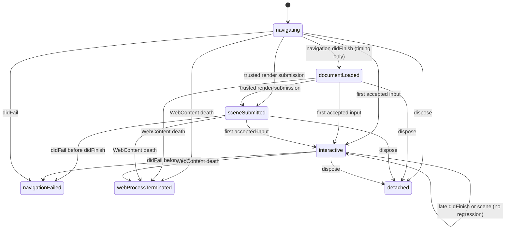

# Actual native player lifecycle and engine authority (Epic #202, atomic #577)

**Source of truth:** The shipping iOS/iPad app's `Hephaestus/Player/PixiPlayer.swift` owns the live SwiftUI sheet, WKWebView, prewarm pool, native nonce, credential scope, current attached lease, player error and result callback. The separate generator repository's `ios/GamePlayerCore/PlayerLaunchCoordinator` is an unintegrated candidate according to parent #203; do NOT say it is simultaneously executing or successfully synchronized with the shipping app.

| Owner | Actual scope | What it does NOT prove |
| --- | --- | --- |
| Native `PlayerWebViewPool` | One pooled WebView, current immutable /player URL, WebKit document nonce, credential epoch, nonzero lease, speculative handoff | JS client session ID is an authentication grant |
| Native `PlayerHostLaunchReducer` | Monotonic document, renderer-submission, accepted input, failure, process-death and detached phases | `didFinish` means Pixi/GPU-ready, or a submitted draw is CA-composited |
| Native WK `Coordinator` | Native-origin/schema/nonce/session/lease/typed message admission, bounded verified run lookup | Client-reported scores/wins are independently attested |
| SwiftUI `PixiPlayerSheet` | Current attempt epoch, safe loading/recovery, poster policy (#353/#566) | A browser-delivered first-scene message proves a compositor pixel |
| Generator Pixi runtime | Load/present published Game IR, submit native schema-v2 *diagnostic* scene/input metrics, opaque run ID | Dynamically load native executable code or self-certify score |
| Go published package/replay backend | Versioned published IR, moderation/authorization, future server-only replay and score attestation | Trust unverified browser verdicts or historical ranks |
| Separate `ios/GamePlayerCore` | Independent abstraction and future integration/retirement decision under #203 | Native Xcode project currently depends on it |

## Production state transition diagram

A fatal `didFail` may arrive after early scene/input callbacks when `didFinish` has not yet been observed. It still retires the current attachment; if `didFinish` was already observed, the reducer rejects that late failure. A live current Coordinator may start a new navigation, resetting its per-document milestones. Failed/terminated/detached Coordinators cannot be revived by stale WebKit callbacks; a fresh owner/lease must be established. A late scene after first accepted input never regresses phase. One scene submission is a **renderer-submitted** milestone, not GPU compositor present; #204/#276 require real hardware p50/p95. First input is a gameplay milestone, not score attestation: generator #382/#402 must independently replay and rank only verified runs.

## Atomic regression vs remaining work

Three pure tests added to the *production reducer's real Swift Testing suite*: 160 schedules covering four distinct ordering permutations, duplicate events, live navigation reset, WebContent death, sheet detach and stale callbacks; 160 fatal-navigation failure/resurrection negatives; and 160 fatal failures following early scene/input callbacks before `didFinish`. The latter case explicitly verifies that a trusted early runtime milestone cannot resurrect a failed navigation. They create no fake player, creator, published package or server score and don't change runtime source/UI behavior. Require seven exact-head native iPhone/iPad GitHub Actions before merging/closing #577.

Parent [#203](https://github.com/GavinDu/Hephaestus/issues/203) stays OPEN for an explicit GamePlayerCore adapter/retirement decision, native-publisher/versioned package integration, cancellation and actual iPhone/iPad evidence. GPU and memory/thermal #276/#279, poster #353, real published creator/package #288/#368 and independent Go replay #382 all remain OPEN. No new JS-to-native control bridge is authorized by this document.