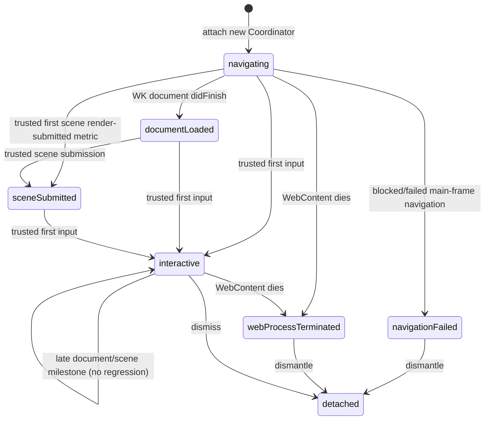

# Production native player launch reducer — incremental #203 integration

Parent: [Hephaestus Epic #202](https://github.com/GavinDu/Hephaestus/issues/202), [single authoritative lifecycle #203](https://github.com/GavinDu/Hephaestus/issues/203).

## Boundary

The **shipping** SwiftUI `PlayerWebView.Coordinator` now owns a pure `PlayerHostLaunchReducer`, used on real WebKit navigation, trusted first-scene submission, first validated input, navigation error, WebContent termination, and detach. The reducer is native presentation/control-plane state **only**. The backend's bundled, trusted PixiJS/Rapier runtime continues to be the *sole gameplay execution engine*, including package authorization, Game IR interpretation, deterministic virtual clock, game rules, physics and scoring. This change does not import or instantiate the generator's standalone `ios/GamePlayerCore.PlayerLifecycle`, which is not linked into the production Xcode project.

## Accepted production events

- Native WK `didFinish` records *document navigation only*; it never promotes the state to `sceneSubmitted` or `interactive`.
- Trusted native metric `first_scene_render_submit` advances the semantic readiness observation once, but it is **not proof of a GPU-composited or nonblank displayed frame**. Input readiness is a separate event. The existing runtime metric schema remains narrow, origin/main-frame/session checked and one way.
- If prewarm handoff causes render/first-input notifications before navigation finish, later notifications fill missing milestones without regressing `interactive`. A late scene-submission after first input is recorded once.
- Failed/terminated/detached Coordinators never accept a later successful navigation, trusted runtime metric, input or process restart. A user retry gets a new `.id(attempt)` and new Coordinator.
- Navigation terminal delivery, scene submission and first accepted input are separately deduplicated in the reducer. The existing Swift `PlayerFirstInputGate` validates and deduplicates the first input *inside* this production reducer rather than as a second independent coordinator field.
- KVO progress notifications are suppressed after fatal navigation failure, process death or detach.
- A legitimate new document navigation retires the bound runtime session ID in a **fixed-size eight-entry denylist**, while clearing prior verified-run and accepted metric IDs. This stops a recently retired document's queued `WKScriptMessage` from becoming the first accepted session after reload. Unknown message kinds never bind a runtime session. Asynchronous verified-result lookups and first-input UI callbacks also recheck the reducer's nonterminal phase.
- **Limitation:** the eight-entry defense is not a cryptographically bound WebKit document identity and cannot exclude a callback from a session older than the retention window. A future backward-compatible runtime/native handshake should carry an unpredictable navigation nonce tied to the current WebView attachment lease and runtime session; reject missing/stale proofs before binding. Do not claim arbitrary-reload provenance from this bounded gate.
- WebContent termination after a terminal navigation failure is ignored rather than overriding the failure or triggering another auto-retry. The Swift transition tests cover this ordering.

## Explicit limits and next design steps

This is the **first production-integrated lifecycle state reducer**, not the entire #203 end state: SwiftUI still owns loading/error/quality/presentation controls while the pool owns WebView/credential attachment. Consolidate UI launch booleans behind this reducer in a follow-up, or explicitly retire the unused standalone generator `PlayerLifecycle` only after impact analysis and canonical package tests. The branch must later integrate the exact-view and attachment-lease fixes #223/#224, memory-pressure cleanup #225 and bounded metric reporting #227 as those receive passing exact-head CI.

Tests exercise cold start, prewarm out-of-order milestones, duplicates, terminal navigation failure, WebContent termination, detach, and legitimate new navigation. Required exact-head iOS Xcode, iPhone/iPad simulator smoke, UI evaluator, presentation contract and real-device separate evidence are mandatory. Physical-device GPU first frame, 50+ lifecycle cycles and memory/thermal baselines are not established by this PR.

## Integrated metric-epoch ownership (2026-11-13)

Staged on #227, this production lifecycle reducer adopts its constant-space
per-kind native metric high-water gate and the one-shot first-scene gate.
On every accepted `didStartProvisionalNavigation`, it rotates the bound
runtime session, clears prior run identifiers, resets
`PlayerRuntimeMetricSequenceGate` and reinstantiates
`PlayerFirstSceneRenderSubmissionGate`. A new document's valid metric
sequence starting at 1 is not rejected because an earlier document used
that sequence. First input is owned by `PlayerHostLaunchReducer`, not a
second independent field. A Swift test exercises two valid navigations.

This is source-level session ownership, not proof of an immutable WebKit
document nonce. Retired-ID history of eight cannot securely bind callbacks
across unbounded reloads, and real hardware GPU-present evidence is missing.
