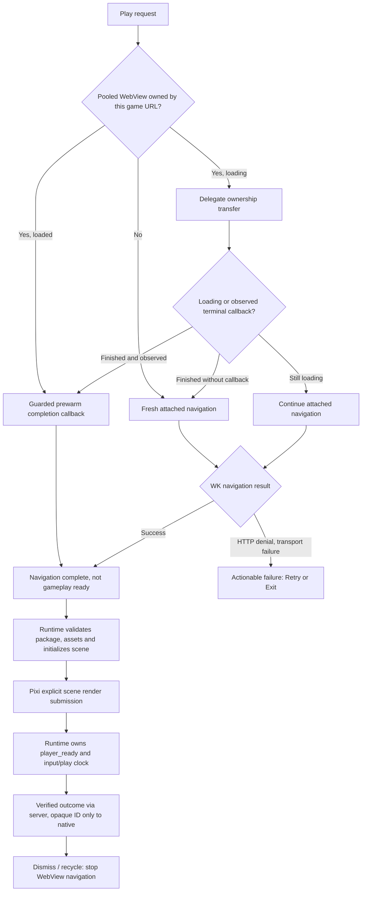

# Hephaestus player runtime lifecycle — production responsibility map

Epic: [#202](https://github.com/GavinDu/Hephaestus/issues/202) · P0 host lifecycle: [#203](https://github.com/GavinDu/Hephaestus/issues/203)

## One authoritative execution runtime

The Game IR interpreter remains the shipped **PixiJS + Rapier** implementation served by `html5-game-generator`. SwiftUI/WKWebView owns navigation, prewarm handoff, user-visible loading/errors, process recovery, and verified-run server lookup, **not** scoring, simulation ticks or arbitrary game code. The nested `ios/GamePlayerCore` Swift package in the backend repository is currently **standalone** and is not linked into this production Xcode target; its package-validation unit tests do not prove this host is using that state machine. Before marking #203 complete, choose a single distributable lifecycle module or explicitly retire the unused abstraction; do not silently fork two transition authorities.

## Current production launch and owner boundaries

1. `PlayerWebViewPool` is the only owner of the reusable WKWebView and the current requested URL. It refuses a previous sheet's recovery after the view is retargeted or detached.
2. `PlayerWebView.Coordinator` owns active navigation callbacks, one-time terminal notification, message origin/session checks, verified-run result lookup and KVO. `stopObserving()` invalidates its ownership and dedup buffers. A late completion, failure, KVO or termination event must not mutate an inactive SwiftUI presentation.
3. A prewarm handoff without a callback is **not** assumed successful: when the expected navigation is no longer loading and the coordinator did not see its finish/failure, the coordinator reloads the same URL with the attached delegate and re-evaluates errors.
4. Only the trusted runtime can signal `player_ready` after scene-render submission. `WKNavigationDelegate.didFinish` remains a separate `TapToNavReady` metric and cannot prove compositor presentation, full interaction readiness or game validity.
5. Backgrounding, connectivity, retry, termination and exit must retain their own explicit bounds; the current automatic process-restart limit is two, with further retry user-initiated.

## Architecture challenger and acceptance gates

The delegate-race recovery is a narrow P0 reliability slice; it does not unify production source code with the backend's independent `GamePlayerCore` package or prove device-level cleanup. Gate the change on Xcode tests, iPhone player smoke, iPad evaluator and presentation pipeline. Unit tests cover the full truth table for inactive/loading/observed/recoverable transitions. Physical iPhone and iPad acceptance still requires cold/prewarmed/rapid-swipe/retry/offline/foreground/termination/50-cycle memory/thermal evidence, and package authorization/invalid hash fixture coverage on the actual player.

**Do not close #203 or Epic #202** just because this handoff race has been addressed.
