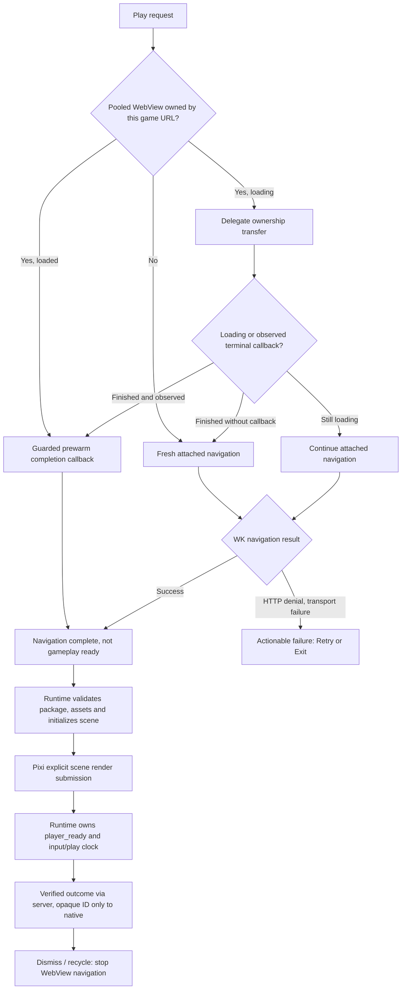

# Hephaestus player runtime lifecycle — production responsibility map

Epic: [#202](https://github.com/GavinDu/Hephaestus/issues/202) · P0 host lifecycle: [#203](https://github.com/GavinDu/Hephaestus/issues/203)

## One authoritative execution runtime

The Game IR interpreter remains the shipped **PixiJS + Rapier** implementation served by `html5-game-generator`. SwiftUI/WKWebView owns navigation, prewarm handoff, user-visible loading/errors, process recovery, and verified-run server lookup, **not** scoring, simulation ticks or arbitrary game code. The nested `ios/GamePlayerCore` Swift package in the backend repository is currently **standalone** and is not linked into this production Xcode target; its package-validation unit tests do not prove this host is using that state machine. Before marking #203 complete, choose a single distributable lifecycle module or explicitly retire the unused abstraction; do not silently fork two transition authorities.

## Current production launch and owner boundaries

1. `PlayerWebViewPool` is the only owner of the reusable WKWebView and the current requested URL. It refuses a previous sheet's recovery after the view is retargeted or detached.
2. `PlayerWebView.Coordinator` owns active navigation callbacks, one-time terminal notification, message origin/session checks, verified-run result lookup and KVO. `stopObserving()` invalidates its ownership and dedup buffers. A late completion, failure, KVO or termination event must not mutate an inactive SwiftUI presentation.
3. A prewarm handoff without a callback is **not** assumed successful: an `isLoading` KVO observer catches transitions after the delegate swap, including a terminal callback routed to the old warmup delegate. When the expected navigation is no longer loading and this attached coordinator did not see its finish/failure, it **disarms recovery before a single reload** under the attached delegate and re-evaluates errors. Already-ended handoffs get a next-main-turn check. Detaching, failure, termination or an observed finish cancels the observer. This never treats `isLoading == false` as gameplay readiness.
4. Only the trusted runtime can signal `player_ready` after scene-render submission. `WKNavigationDelegate.didFinish` remains a separate `TapToNavReady` metric and cannot prove compositor presentation, full interaction readiness or game validity.
5. Backgrounding, connectivity, retry, termination and exit must retain their own explicit bounds; the current automatic process-restart limit is two, with further retry user-initiated.

## Architecture challenger and acceptance gates

The delegate-race recovery is a narrow P0 reliability slice; it does not unify production source code with the backend's independent `GamePlayerCore` package or prove device-level cleanup. Gate the change on Xcode tests, iPhone player smoke, iPad evaluator and presentation pipeline. Unit tests cover the full truth table for inactive/loading/observed/recoverable transitions. Physical iPhone and iPad acceptance still requires cold/prewarmed/rapid-swipe/retry/offline/foreground/termination/50-cycle memory/thermal evidence, and package authorization/invalid hash fixture coverage on the actual player.

**Do not close #203 or Epic #202** just because this handoff race has been addressed.

## Main-document navigation boundary (P0 security follow-up)

The native pooled WKWebView must not follow a game-controlled top-level URL to
another game ID, quality/presentation variant, scheme, origin, or arbitrary
website. `PlayerMainFrameNavigationPolicy` checks the exact canonical
`/player?game=...&quality=...&presentation=play` URL; the pool additionally
checks that the WKWebView still belongs to the active URL, and the attached
Coordinator binds the URL to its own game session. The unattached warmup
delegate enforces the same restriction. The only deliberate exception is
`about:blank` during pool recycling, when no game URL is current.

This is **main-frame isolation** only: subframe/resource fetching remains
subject to WebKit/CSP and the backend package/asset permission gates. It is
not a substitute for moderation, content revocation, cache invalidation,
CSP review, or Apple App Review Guideline 4.7 verification. Negative URL
policy unit tests cover same-origin game swapping, renderer quality, scheme,
foreign origin and teardown. Verify real initial redirects and attempted
external navigation on iPhone/iPad before calling the issue complete.

## Late prewarm completion ownership guard (#202, #203, #205)

WKWebView's `didFinish` may arrive after the user starts a different game,
retries, dismisses, or changes the Keychain credential. A successful network
finish is **not** a transferable entitlement to cache a prewarmed game. The
only legitimate `loadedURL` transition requires all three facts:

1. The callback's **exact WKWebView instance** is the current pooled view.
2. The expected pooled game/quality URL is present and exactly matches the
   finished WebView URL.
3. The Keychain credential scope has been rechecked synchronously, so a
   queued login/logout notification cannot authorize an old page.

These checks apply to **both** speculative warmup finishes and attached
player finishes; the view does not need to be attached to become warm.
A recycled, detached or credential-invalidated view cannot mark the pool
as loaded even if the new account later opens the **same** game URL.
Native Swift Testing covers matching, mismatched game/quality, nil
expected/actual URL and old-view/same-URL cases.

A successful `loadedURL` means only that WK navigation finished. It
must **never** be interpreted as semantic game readiness, first WebGL
composition, verified asset integrity, or first interactive input. The
outstanding authoritative host-state-model issue #203 and real-device
readiness/performance #204 are not resolved by this ownership guard.
